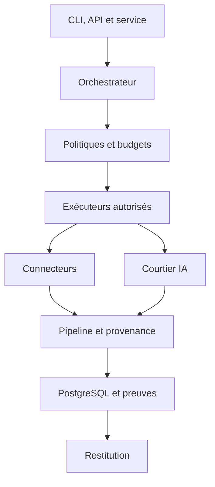

# OSIA — Cadrage technique T3

> **Édition consolidée : 1.1 — 06/11/2026.** Les arbitrages conservent leur validation initiale. Cette édition harmonise les formulations avec les lots ultérieurs ; elle ne vaut pas attestation de développement. Références : [index](../README.md), [résolutions de cohérence](../AUDIT-COHERENCE.md), [registre des décisions](../../COWORKAI/DECISIONS.md).

## Langage et architecture du moteur

- **Version :** 1.1
- **Date de validation :** 6 novembre 2026
- **Statut :** VALIDÉ — LOT CLÔTURÉ
- **Périmètre :** langage principal, architecture du cœur d'exécution, orchestration, concurrence, persistance d'état, contrats internes, extensions, intégration IA, chaîne de traitement, politiques d'exécution, erreurs, journalisation et tests.
- **Nature :** décisions d'architecture opposables aux futures implémentations. Ce document décrit la cible et non la disponibilité immédiate de chaque fonctionnalité.

## 1. Contexte et contraintes héritées

OSIA est un outil d'investigation OSINT sur sources publiques, destiné à accélérer les recherches, établir des liens entre entités, conserver la provenance des informations et restituer les résultats de manière contrôlable. Le moteur propose et exécute des recherches sous limites explicites : profondeur, budgets et autorisations.

Le présent lot respecte les cadrages antérieurs, notamment :

- **T1 — Architecture d'exécution :** Linux ; séparation du cœur moteur et des interfaces ; installation orientée Desktop ou Server ; paquet applicatif commun, interface Web facultative ; futur client natif Rust/GTK4/libadwaita ; communication API REST et événements SSE ; activation conditionnelle des services ; mises à jour manuelles avec notifications.
- **T2 — Stockage et sauvegarde :** PostgreSQL principal ; stockage hybride/dédupliqué ; répertoires Linux configurables ; intégrité renforcée ; sauvegardes cohérentes et chiffrement gradué.
- **Lots fonctionnels A, B, C et D :** ramifications supervisées, catalogues et connecteurs OSINT évolutifs, gestion des preuves et des décisions humaines, maîtrise stricte des appels API et des budgets, restitution reproductible des informations enregistrées.

> Les décisions fonctionnelles précédentes ne sont pas rouvertes par T3. Lorsqu'un détail est traité dans un autre lot, T3 précise l'organisation technique sans remplacer l'arbitrage de ce lot.

## 2. Tableau de validation

| Référence | Décision | Option validée |
|---|---|:---:|
| T3.1 | Python comme langage principal du moteur | **A** |
| T3.2 | Monolithe modulaire évolutif | **C** |
| T3.3 | Moteur autonome avec points d'entrée CLI, API, service et internes | **C** |
| T3.4 | Orchestrateur d'investigation dynamique supervisé | **C** |
| T3.5 | Modèle hybride asynchrone et multiprocessus | **C** |
| T3.6 | État persistant avec journal d'exécution et reprise contrôlée | **C** |
| T3.7 | Contrats d'échange typés, versionnés et découplés | **C** |
| T3.8 | Extensions déclaratives avec isolation graduée | **C** |
| T3.9 | Courtier IA centralisé avec adaptateurs fournisseurs | **C** |
| T3.10 | Chaîne de traitement séparée avec provenance et validation | **C** |
| T3.11 | Moteur de politiques indépendant et autorisations transactionnelles | **C** |
| T3.12 | Gestion contextuelle des erreurs et des interruptions | **C** |
| T3.13 | Journalisation structurée, observabilité avancée différée | **B** |
| T3.14 | Tests multicouches incluant simulations d'investigations | **C** |

**Validation utilisateur :** ensemble des quatorze arbitrages accepté sans réserve le 6 novembre 2026.

## 3. Décisions détaillées

### T3.1 — Langage du moteur : Python (A)

Le cœur du moteur est développé en Python pour bénéficier de son écosystème OSINT, IA, analyse documentaire et intégration réseau. Il n'est pas prévu d'imposer une double pile Python/Rust en V1. Des composants Rust ciblés pourront être introduits ultérieurement lorsqu'un besoin de performance ou d'isolation sera démontré ; cette possibilité ne modifie pas le choix initial. Le futur client Desktop en Rust est indépendant du langage du moteur.

### T3.2 — Organisation : monolithe modulaire (C)

Une application unique regroupe des modules aux responsabilités et interfaces explicites : orchestration, politiques, tâches, connecteurs, IA, analyse, graphe, persistance et restitution. Certains traitements peuvent être isolés dans des processus distincts. Les microservices distribués ne constituent pas un prérequis ; on évite leur complexité tant qu'elle n'est pas justifiée.

### T3.3 — Points d'entrée : moteur autonome multi-interfaces (C)

Le moteur doit pouvoir être invoqué par une interface CLI, une API REST avec diffusion des événements par SSE, un service en arrière-plan, ainsi que par des appels Python internes. Le paquet commun et les choix d'installation Desktop/Server déterminent l'activation des services et interfaces. L'interface Web reste optionnelle. La CLI doit permettre le fonctionnement et les tests indépendamment d'une interface graphique.

### T3.4 — Orchestration : dynamique, mais supervisée (C)

Un orchestrateur pilote une machine à états d'investigation, avec tâches et branches liées à une investigation parente. Les IA peuvent proposer de nouvelles pistes, des priorités ou des rapprochements, mais ne décident jamais seules de lancer des opérations hors des politiques. Les transitions, validations et limites sont vérifiées par une composante indépendante. Une investigation peut s'arrêter une fois l'objectif suffisamment étayé et proposer une prolongation uniquement après autorisation explicite, selon le cadrage fonctionnel.

### T3.5 — Concurrence : asyncio + processus isolés (C)

Les opérations d'entrées-sorties (HTTP, API, requêtes externes) utilisent une exécution asynchrone. Les traitements lourds ou qui nécessitent une isolation peuvent être déportés dans des processus séparés. Les seuils de concurrence sont configurables et ne permettent pas de contourner les quotas ni les plafonds budgétaires.

### T3.6 — État des investigations : durable et réconciliable (C)

Chaque investigation et branche possède un état persistant : étapes, opérations prévues/en cours/terminées, résultats intermédiaires, appels externes, consommations, décisions humaines et erreurs. Un journal complète cet état pour l'audit et la reprise. Après une interruption, les opérations incertaines sont réconciliées avant toute relance ; on ne rejoue pas aveuglément les appels qui pourraient être facturés ou avoir des effets non idempotents. Le choix ne requiert pas un event sourcing intégral.

### T3.7 — Échanges internes : contrats typés et versionnés (C)

Les frontières des modules reposent sur des modèles typés, des schémas et des interfaces documentées ; la sérialisation est réservée aux frontières qui le nécessitent (API, IPC, persistance, export). Les formats et contrats externes ou persistés doivent évoluer de manière maîtrisée et versionnée. Les appels Python internes ne doivent pas subir de sérialisation JSON inutile.

### T3.8 — Extensibilité : plugins déclaratifs et isolation graduée (C)

OSIA distingue les composants officiels intégrés et les extensions additionnelles. Les extensions sont décrites par un manifeste (identité, version, compatibilité, capacités, permissions, accès réseau et dépendances). L'installation/activation d'extensions externes requiert une décision autorisée ; le degré d'isolation dépend du niveau de confiance. Une simple séparation en processus n'est pas assimilée à une sandbox de sécurité : l'isolation effective suppose des restrictions du système d'exploitation. Les extensions officielles intégrées sont prioritaires en V1 ; l'architecture reste prête pour l'extension.

### T3.9 — Interaction IA : courtier centralisé (C)

Un courtier IA fournit des adaptateurs indépendants des fournisseurs ; il gère les capacités des modèles, les réponses structurées, les quotas, les estimations et rapprochements de coûts, les erreurs et les replis autorisés. Le courtier transmet au moteur des propositions structurées : l'IA ne reçoit pas d'accès non supervisé aux connecteurs ou aux actions coûteuses. Toute tentative/reprise et tout basculement fournisseur restent soumis aux politiques et budgets.

### T3.10 — Traitement des résultats : pipeline avec provenance (C)

Séparer explicitement : collecte brute → normalisation → extraction d'entités → détection de relations → évaluation des preuves → graphe et analyses → restitution. Les pièces et contenus originaux demeurent disponibles et attribuables à leurs sources. Les assertions de l'IA sont distinctes des faits étayés et des décisions de l'utilisateur. Les corrections et validations peuvent actualiser les vues sans nécessiter systématiquement une nouvelle collecte ni un appel IA payant.

### T3.11 — Politiques : contrôle indépendant et transactionnel (C)

Un moteur de politiques vérifie avant chaque opération sensible : profondeur, permissions, types d'accès, règles des connecteurs, limites de collecte, budgets, coûts estimés et concurrence. Les opérations payantes réservent préalablement une enveloppe autorisée ; leurs consommations réelles sont réconciliées ensuite. Lorsque la dépense ne peut pas être correctement bornée, l'opération est bloquée ou nécessite une validation appropriée. Aucune IA ni aucun module d'orchestration ne peut contourner ces contrôles.

### T3.12 — Incidents : traitement contextuel (C)

Les erreurs sont classifiées : temporaires, permanentes, liées aux quotas, aux budgets, aux sources ou à la cohérence des données. Les reprises et temporisations sont limitées ; les résultats partiels restent conservés. Une source défaillante ne provoque pas nécessairement l'échec global de l'investigation. Un arrêt utilisateur suspend proprement les opérations ; un redémarrage produit une réconciliation contrôlée. Les appels non idempotents ou facturables ne sont pas automatiquement relancés sans précaution.

### T3.13 — Observabilité : journalisation structurée (B)

Chaque investigation, branche, opération et erreur est traçable au moyen d'identifiants de corrélation et de journaux structurés. Les informations enregistrées couvrent notamment horodatages, durées, états, composants sollicités, erreurs et consommations, avec masquage des secrets et minimisation des informations sensibles. Les métriques exhaustives, les traces distribuées et les tableaux de bord techniques ne sont pas requis en V1, mais leur intégration ultérieure reste possible.

### T3.14 — Qualité : tests multicouches et simulations (C)

Mettre en place tests unitaires, intégration, contrats, scénarios de bout en bout et non-régression. Prévoir des substituts simulant sources, connecteurs et fournisseurs IA afin de tester les coûts, limites, erreurs, interruptions, reprises, isolation des investigations, corrections humaines et cohérence des résultats sans dépenses API. Les tests doivent être intégrables aux processus CI et aux revues de code des agents de développement.

## 4. Architecture logique de référence

Le schéma illustre les responsabilités, **pas une obligation de séparer physiquement tous les éléments**. Les opérations sur les données sont encadrées par une couche de persistance ; les dépenses et permissions par les politiques. L'interface n'embarque pas de logique métier qui dupliquerait celle du moteur.

## 5. Principes transversaux validés

1. **Moteur indépendant des interfaces.** La CLI et les tests peuvent utiliser le cœur sans interface Web ni Desktop.
2. **Dégradabilité en absence d'IA.** Consulter les investigations existantes, naviguer dans les graphes et corriger les résultats ne doit pas exiger un fournisseur IA lorsque ces opérations n'impliquent aucun raisonnement génératif.
3. **Traçabilité des connaissances.** Les sources, les observations, les hypothèses IA et les décisions humaines demeurent distinguables.
4. **Protection des budgets.** Aucune opération payante ne contourne la réservation et le contrôle des dépenses.
5. **Reprise sans duplication incontrôlée.** Toute reprise vérifie les effets déjà produits.
6. **Complexité progressive.** Préparer les frontières des modules dès la V1, sans implémenter prématurément toutes les possibilités avancées.
7. **Respect des arbitrages T1/T2 et des lots fonctionnels.** T3 s'y articule et ne les remplace pas.

## 6. Conséquences pour l'implémentation

- Privilégier Python pour le moteur initial ; ne pas ajouter Rust côté moteur par anticipation.
- Définir des interfaces nettes entre orchestrateur, politiques, courtier IA, connecteurs, pipeline et stockage.
- Concevoir dès l'origine les modèles d'état d'investigation et de branche, ainsi que les identifiants de corrélation.
- Prévoir des adaptateurs simulés pour les tests hors ligne.
- Ajouter progressivement les comportements avancés après validation par des tests vérifiables.
- Documenter les contrats persistés et externes avant leurs évolutions incompatibles.

## 7. Statut final

**Le lot T3 est validé et clos le 6 novembre 2026.**

Toutes les propositions T3.1 à T3.14 ont été acceptées telles quelles. Le présent document constitue la édition consolidée **1.1** à utiliser dans les travaux techniques ultérieurs sur OSIA.
